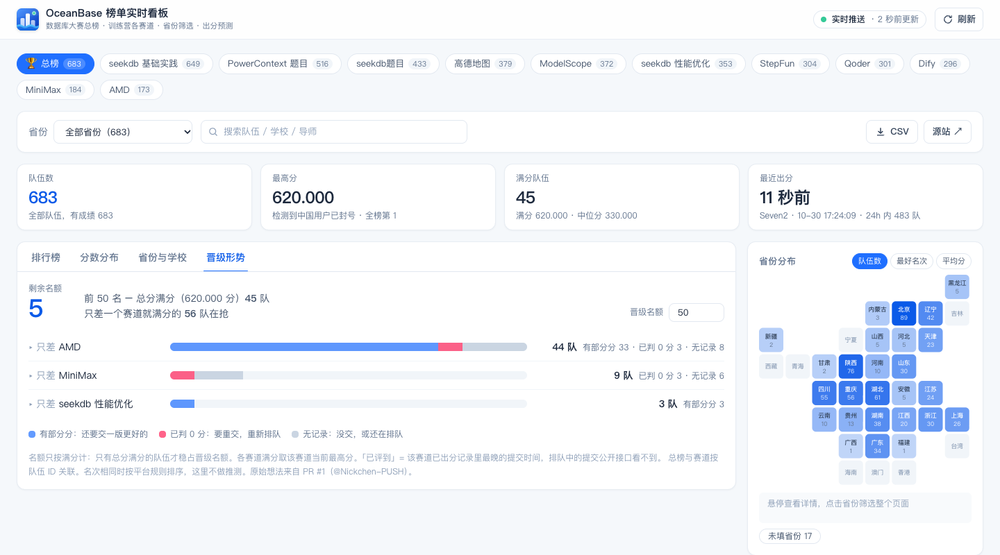
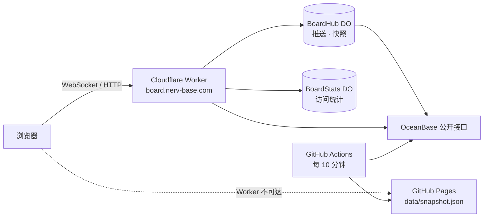

<div align="center">


# OceanBase 榜单实时看板

**数据库大赛总榜 · seekdb AI 训练营 11 个赛道 —— 全量名单、按省份筛选、出分预测，一页看清**

[](https://zzstar101.github.io/oceanbase-live-board/)
[](https://board.nerv-base.com/)
[](https://github.com/zzstar101/oceanbase-live-board/actions/workflows/pages.yml)
[](LICENSE)


[功能](#-功能) · [快速开始](#-快速开始) · [部署](#-部署) · [接口](#-接口) · [出分预测](#-出分预测) · [修掉的问题](#-这次重构修掉的问题)

<br />


</div>

<br />

官方页面只显示 Top 10。本看板直连同一套公开接口（`pageSize=5000`）拿**全量**数据，由服务端中转、缓存并通过 WebSocket 实时推送。

## ✨ 功能

<table>
<tr>
<td width="50%" valign="top">

### 🗺️ 按省份筛选
下拉框、**省份瓦片地图**、省份表——点哪儿都能筛。整页（榜单、指标、分数分布、动态、CSV）随之切换，并显示「省内名次」，也能单独看「未填省份」。

</td>
<td width="50%" valign="top">

### ⏱️ 出分耗时与预测
每个赛道的提交→出分耗时散点图（对数轴，扣除评测暂停）。填入提交时间，给出**预计出分时刻 + 80% 区间**，并公开近 24 小时的回测误差。

</td>
</tr>
<tr>
<td valign="top">

### ⭐ 关注我的队伍
点 ☆ 关注（只存在浏览器本地），顶部卡片常驻它的总榜名次与各赛道名次，榜单里高亮。

</td>
<td valign="top">

### 📈 分数分布与分数线
直方图（离散计分的赛道每个分值一档，满分扎堆单独成档）+ 第 1/10/50/100/200 名分数线，关注的队伍显示「离下一档还差几分」。

</td>
</tr>
<tr>
<td valign="top">

### 🔔 实时动态
最近 1/6/24 小时谁出了分；页面开着期间检测到的**分数增量与名次升降**会叠加上去，榜单行也会闪一下。

</td>
<td valign="top">

### 🏫 省份与学校
各省 / 各校的队伍数、前 10 人数、最好名次、平均分，点学校即搜索该校。

</td>
</tr>
<tr>
<td colspan="2" valign="top">

### 🏁 晋级形势
剩余名额 = 名额（可改）− 总分满分队数；列出**只差一个赛道就满分**的队伍，按赛道分组并区分「有部分分 / 已判 0 分 / 无记录」，附该赛道「已评到」的提交时刻。想法与第一版实现来自 [@Nickchen-PUSH](https://github.com/Nickchen-PUSH) 的 [PR #1](https://github.com/zzstar101/oceanbase-live-board/pull/1)。

</td>
</tr>
<tr>
<td valign="top">

### 🧾 队伍详情
原生 `<dialog>`：总榜名次、总分（= 各赛道之和）、每个赛道的成绩 / 满分 / 最优提交与耗时，以及「现在提交预计何时出分」。

</td>
<td valign="top">

### 🛠️ 还有
WebSocket gzip 推送（失败退回轮询）· CSV 导出（可按省份）· 访问统计后台 `/stats` · 暗色模式 · 手机适配 · 所有状态都在 URL 里可直接分享

</td>
</tr>
</table>

```
?board=q600080&province=四川省&tab=timing&team=g5593
```

### 截图

| 按省份筛选 | 出分耗时与预测 |
| :---: | :---: |
|  |  |
| **队伍详情** | **分数分布与分数线** |
|  |  |
| **晋级形势** | **省份与学校（暗色）** |
|  |  |
| **手机** | |
|  | |

## 🚀 快速开始

需要 [Bun](https://bun.sh) ≥ 1.2。

```bash
bun install
bun run dev          # → http://127.0.0.1:8791
```

| 命令 | 作用 |
| --- | --- |
| `bun run dev` | 开发服务（`Bun.serve` + HTML import，前端由 Bun 原生打包） |
| `bun run start` | 生产模式（启动时打包、压缩） |
| `bun test` | 单元测试：上游解析 / 缓存 / CSV / API / 统计 / 耗时模型 / 预测 / 洞察 / 晋级 |
| `bun run typecheck` | `tsc`（前端 + 服务端）；Worker 另有 `tsconfig.worker.json` |
| `bun run backtest` | 出分预测回测（`--md` 输出 Markdown 表格） |
| `bun run build` / `build:pages` | 打包前端 / 构建 GitHub Pages 静态版 |

## 🧱 技术栈

尽量用原生能力，运行时依赖只有 6 个包。

| 层 | 用了什么 |
| --- | --- |
| 运行时 | **Bun**：`Bun.serve` 路由 + HTML import、WebSocket pub/sub、`Bun.gzipSync`、`bun:sqlite`、`Bun.build`、`bun test` |
| API | **Hono**：同一套路由跑在 Bun 与 Cloudflare Worker 上 |
| 前端 | **React 19** + **TanStack** Query（获取 / 轮询 / 推送写缓存）· Router（URL 即状态）· Table（排序）+ **Tailwind CSS v4** |
| 浏览器原生 | `<dialog>`、`DecompressionStream`、CSS `content-visibility`（代替虚拟滚动）、`color-mix()`、`prefers-color-scheme`、`sendBeacon`、手写 SVG 图表 |
| 边缘 | **Cloudflare Workers**：Durable Objects（RPC + WebSocket Hibernation + alarm）、Cache API、`CompressionStream` |

<details>
<summary><b>目录结构</b></summary>

```
src/
├── shared/            # 纯 TS，浏览器 / Bun / Worker 通用
│   ├── types.ts  format.ts（北京时间格式化）  province.ts（省份筛选与统计）
│   ├── timing.ts  predict.ts  stats.ts        # 耗时清洗模型、出分预测 + 回测（见 docs/prediction.md）
│   ├── insights.ts                            # 学校统计、分数分布、分数线、快照 diff、实时动态
│   └── promotion.ts                           # 晋级形势（PR #1）
├── server/
│   ├── upstream.ts    # 上游抓取、归一化、排名、按 groupId 补全、TTL 缓存 + stale-while-error
│   ├── app.ts         # Hono API（两端共用）
│   ├── csv.ts  visits.ts
│   └── bun.ts         # 本地服务入口
├── worker/index.ts    # Cloudflare Worker 入口：BoardHub / BoardStats 两个 Durable Object
└── web/               # React 前端（index.html 为打包入口）
scripts/  build.ts  build-pages.ts  backtest.ts
tests/
```

</details>

## ☁️ 部署

> [!NOTE]
> 浏览器**不能**直接请求上游：任何非 `open.oceanbase.com` 的 `Origin` 都被网关 403，响应也没有 CORS 头，所以必须有一个中转。



**Cloudflare Worker（实时）**

```bash
bun run worker:deploy                 # = bun run build && wrangler deploy
bunx wrangler secret put STATS_KEY    # 访问统计口令（可选）
```

- 静态资源 `dist/client`（Workers Assets，SPA 回退），`/api/*` 先进 Worker。
- `/api/snapshot` 优先用 `BoardHub` 里 45 秒内的推送快照（直接回 gzip 字节），否则走边缘缓存（12 秒新鲜，300 秒内先回旧数据再后台刷新）。
- `/api/stream` 进 `BoardHub`（Hibernation API），有连接时每 15 秒 alarm 抓一次并广播，没人在线就停。
- 没用 `*.workers.dev`：本机网络对 workers.dev 的 SNI 被阻断，所以挂了自有域名（`wrangler.jsonc` 的 `routes[].custom_domain`）。

**GitHub Pages（静态外壳 + 兜底快照）**

`.github/workflows/pages.yml` 每 10 分钟 `bun test` → `bun run build:pages` → 部署 `dist/pages`。页面优先读 Worker 实时接口，不可达时读同目录的 `data/snapshot.json`（顶栏显示「静态快照」）；上游抓取失败时 job 失败，旧页面保持不变。

**任意主机**：`HOST=0.0.0.0 bun run start`。

## 🔌 接口

| 路由 | 说明 |
| --- | --- |
| `GET /api/health` | 存活、campId、缓存 TTL、运行时、是否开启推送 / 统计 |
| `GET /api/snapshot[?force=1]` | 总榜 + 全部赛道（约 1.3 MB，gzip 后约 200 KB）；`X-Source` 头说明来源 |
| `GET /api/board/<id>` | 单个榜单，`id` = `total` / `q600071` / `600071` |
| `GET /api/export.csv?board=<id>[&province=<省份全称>]` | CSV；`province=__none__` 导出未填省份的 |
| `GET /api/online` | 实时推送连接数 |
| `WS /api/stream` | 推送：每帧是 gzip 后的快照 JSON |
| `POST /api/hit` | 匿名打点 `{k:"pv"\|"board"\|"csv"\|"out"\|"predict"\|"province", t?, r?}`，204 |
| `GET /api/stats?days=14` | 统计汇总，需 `Authorization: Bearer <STATS_KEY>`（或 `?key=`）；key 错 404，未配置 503 |

<details>
<summary><b>上游接口与踩过的坑</b></summary>

```
题目列表  GET https://openwebapi.oceanbase.com/api/techcamp/testplatform/question/webQueryTestPlatformQuestionList
             ?rpcFromType=0&campId=21&pageSize=200&pageNo=1
赛道榜    GET .../testplatform/score/queryTestPlatformScoreList?questionId=600071&pageSize=5000
总榜      GET .../testplatform/score/queryCompetitionScoreList
             ?rpcFromType=0&pageNo=1&pageSize=5000&campId=21&scoreType=0
```

- `queryTestPlatformScoreList` 忽略 `pageNum`，`pageSize` 等价于 LIMIT，`total` 只是本次返回条数。
- `queryCompetitionScoreList` 是真分页，必须同时带 `campId` 与 `scoreType=0`。
- 赛道榜每行是「该队最优那次提交」：`gmtCreate` = 提交时刻，`gmtModified` = 出分时刻（只在提分时一起变），两者之差就是这次提交的真实耗时。
- 赛道榜的 `userId` 只是「交的那个成员」，和总榜按 `userId` 只能对上 62–90%；**`groupId`（队伍 id）100% 对得上**，所以队伍关联、学校 / 省份补全全部按 `groupId`。

</details>

## 🐛 这次重构修掉的问题

| 问题 | 影响 | 现在 |
| --- | --- | --- |
| 总榜与赛道按 `userId` + 队名关联 | 约 1/3 的队伍详情里赛道成绩缺失，同名队会串；旧 README「总榜 ≠ 赛道之和（372/622 吻合）」的结论其实是这个 bug 造成的 | 按 `groupId` 关联，**全部队伍总分 = 各赛道之和** |
| 赛道行「有学校就跳过补全」 | 每个赛道 20%+ 的行没有省份，按省份统计会漏 | 学校 / 导师 / 省份逐字段补 |
| 名次直接用接口顺序 | 接口不按分数排时名次全错 | 稳定排序后按竞赛规则赋名次 |
| 缓存失败兜底 `{...prev.value}` | 题目列表（数组）被摊成对象 → `.map is not a function`；失败的 promise 被缓存整个 TTL | 统一包装 `Cached<T>`；无兜底时失败立即清掉 |
| Worker 推送快照没有过期判断 | 没人在线时 alarm 停了，`/api/snapshot` 可能回几天前的数据 | 超过 45 秒不用 |
| 统计 `days=abc` | `NaN` 导致异常；区间 UV 只算了最后一天 | 1–60 天夹取；给出日 UV 之和与峰值 |
| 变动对比每次轮询都覆盖上一版 | 增量刚出现，下一轮（数据没变）就消失 | 只在快照换代时比较，变化保留 30 分钟 |
| 无成绩排在降序第一；CSV 没有省份列、没转义 `\r` | 排序 / 导出错误 | 已修；CSV 另加公式注入防护 |
| 耗时对比混入总榜；耗时缓存无限增长；`fmtDur(0)` 显示空；「90 分钟前」显示成「2 小时前」；Pages 上提示「无法连接本地服务」 | 显示错误 / 内存泄漏 | 已修 |
| 出分预测：评测时间算了两遍、两端点速率对异常点敏感、夜间不评测的赛道当排队外推、判断顺序错、窗口相对最后提交而非现在、批量时段用浏览器时区 | 中位误差 18 分钟，80% 区间实际只命中 31% | 重写，见下节 |

## 🎯 出分预测

公开接口看不到「排队中」的提交，只能用已出分的记录反推。新算法见 `src/shared/predict.ts`，推导与全部回测数据在 **[docs/prediction.md](docs/prediction.md)**。

1. **工作时钟**：从历史里学出每个赛道「有作业在等、却没有任何出分」的北京时间时段（例如夜间不评测），这些时段不计入等待。
2. **点估计**：最近 5 条出分记录在工作时钟下的耗时中位数（旧算法把「队头」再加一次评测时间，系统性偏晚）。
3. **80% 区间**：回放该赛道历史上「预测 / 实际」的比值分布，并按「已经等了多久」做条件校准。
4. **状态判断**：疑似停摆 → 已超时 → 跨休息时段 → 快速评测 → 正常排队；停摆时直接说「无法预测」而不是编一个时间。
5. 面板公开该赛道**近 24 小时回测**的中位误差与区间命中率，自己判断能信几分。

回测（真实出分记录回放，旧 → 新）：

| 场景 | 中位绝对误差 | 80% 区间命中率 |
| --- | :---: | :---: |
| 滚动起点 · 正常时段（4283 例） | 12 分钟 → **3.5 分钟** | 37% → **74%** |
| 滚动起点 · 全部（5138 例） | 18 分钟 → **6.7 分钟** | 31% → **66%** |
| 跨快照：1029 时刻已提交未出分（194 例） | 17.3 小时 → **8.4 小时** | 6% → **80%** |

> [!WARNING]
> 平台停摆本身不可预测（高德、Qoder 出现过 5–16 小时零出分）；Dify / AMD / MiniMax 这类慢赛道误差仍在小时级；榜单只保留每队最好一次提交，没提分的提交看不到。

**耗时清洗**：相邻出分间隔 ≥ `max(60 分钟, 10 × 间隔中位数)` 视为评测暂停，跨暂停的作业扣掉重叠部分；清洗后仍 > `max(P99, 10 × 中位数, 60 秒)` 的剔除。面板下方会写明这次清洗做了什么。

## 📊 访问统计

全部自统计（Worker 用 `BoardStats` Durable Object，本地用 `bun:sqlite`），按北京时间切天，**不用第三方脚本、不写 cookie、不存原始 IP**：

- **PV / UV**：UV 按 `hash(日期 + IP + UA)` 去重，跨天不可关联，所以区间给「日 UV 之和」与「单日峰值」
- **来源**（GitHub / 飞书 / 微信·QQ / 搜索引擎 / B 站 / 小红书 / 社交平台 / 直接访问）、**地区**（`request.cf.country`）、**设备**
- **事件**：切换榜单、省份筛选、CSV 导出、外链点击、使用出分预测；当前在线 = 推送连接数；本机访问不打点

后台 `/stats`：输入 `STATS_KEY`（或用 `/stats?key=…` 打开，key 会从地址栏移除），7/14/30 天，30 秒刷新。本地开启：设置环境变量 `STATS_KEY` 或在项目根放 `.stats-key` 文件（已 gitignore）。

<details>
<summary><b>⚙️ 环境变量</b></summary>

| 变量 | 默认 | 说明 |
| --- | --- | --- |
| `PORT` / `HOST` | `8791` / `127.0.0.1` | 本地服务监听地址 |
| `CAMP_ID` | `21` | 训练营 id |
| `CACHE_TTL_MS` | `12000` | 上游结果缓存时长 |
| `UPSTREAM_TIMEOUT_MS` | `15000` | 单次上游请求超时（3 次退避重试） |
| `PUSH_INTERVAL_MS` | `15000` | 本地 WebSocket 推送间隔（≥ 5000） |
| `STATS_KEY` | 无 | 统计后台口令；Worker 上用 `wrangler secret put` |
| `STATS_DB` | `.cache/stats.sqlite` | 本地统计数据库 |
| `HMR` | 关 | `HMR=1` 开启 Bun 前端热更新（Bun 1.4 的 HMR 运行时处理不了 TanStack Router 内部的循环 import，默认关闭，改前端刷新页面即可） |
| `LIVE_ORIGIN` | `https://board.nerv-base.com` | Pages 构建时注入的实时接口地址 |

</details>

<br />

<div align="center"><sub>以 <a href="LICENSE">MIT</a> 协议开源 · 数据来自 <a href="https://open.oceanbase.com/">open.oceanbase.com</a> 公开榜单接口，本项目与 OceanBase 官方无关。</sub></div>
