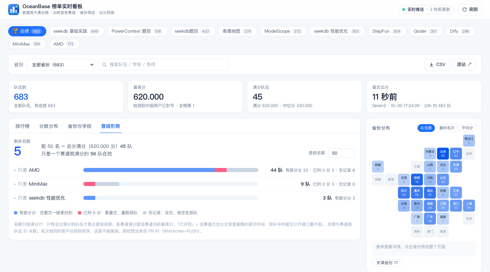

<div align="center">


# OceanBase 榜单实时看板

**数据库大赛总榜 · seekdb AI 训练营 11 个赛道 · 加赛榜 —— 全量名单、按省份筛选、出分预测，一页看清**

[](https://zzstar101.github.io/oceanbase-live-board/)
[](https://board.nerv-base.com/)
[](https://github.com/zzstar101/oceanbase-live-board/actions/workflows/pages.yml)
[](LICENSE)

</div>

## ⚡ 由 OceanBase 强力驱动

<table>
<tr>
<td width="180" align="center"><a href="https://www.oceanbase.com/"><picture><source media="(prefers-color-scheme: dark)" srcset="src/web/assets/sponsors/oceanbase-dark.svg" /></picture></a></td>
<td><b><a href="https://www.oceanbase.com/">OceanBase</a></b> · 分布式 · AI 数据库。完全自研，高度兼容 MySQL / Oracle，一套系统承载交易、实时分析与 AI 负载。<a href="https://www.oceanbase.com/">官网</a> · <a href="https://github.com/oceanbase/oceanbase">GitHub</a> · <a href="https://open.oceanbase.com/">社区</a></td>
</tr>
<tr>
<td width="180" align="center"><a href="https://powercontext.oceanbase.io/zh/"><picture><source media="(prefers-color-scheme: dark)" srcset="src/web/assets/sponsors/powercontext-dark.png" /></picture></a></td>
<td><b><a href="https://powercontext.oceanbase.io/zh/">PowerContext</a></b> · Agent 记忆。给 Claude Code / Codex 的长期记忆与上下文交接：换个新会话，决策、约束和进度不用再交代一遍。<a href="https://powercontext.oceanbase.io/zh/">官网</a> · <a href="https://github.com/oceanbase/powercontext">GitHub</a></td>
</tr>
<tr>
<td width="180" align="center"><a href="https://www.seekdb.ai/"><picture><source media="(prefers-color-scheme: dark)" srcset="src/web/assets/sponsors/seekdb-dark.svg" /></picture></a></td>
<td><b><a href="https://www.seekdb.ai/">seekdb</a></b> · AI 原生搜索数据库。向量、全文、结构化数据混合检索，一个引擎搞定，嵌入式即开即用，很适合给 Agent 当存储。<a href="https://www.seekdb.ai/">官网</a> · <a href="https://github.com/oceanbase/seekdb">GitHub</a></td>
</tr>
</table>


<br />

官方页面只显示 Top 10，这里是**全部队伍**。直接打开就能用，不用登录：

- **在线看板** <https://zzstar101.github.io/oceanbase-live-board/> —— 公开首页，优先接收实时数据；实时服务连不上时自动使用每 10 分钟更新的快照
- **实时直连** <https://board.nerv-base.com/> —— 实时后端与同源看板，有新成绩会自动推送到页面

## 怎么用

| 想看什么 | 怎么做 |
| --- | --- |
| 某个赛道 | 点顶部的赛道标签，数字是参赛队伍数 |
| **加赛榜** | 顶栏切到「加赛榜」：一个题目、两个子题（性能评测 / Agent Prompt），一次提测同时产生两项成绩；综合主榜用「综合（总分） / 性能 / Prompt」切换排序，总榜沿用初赛榜的列结构，切到性能/Prompt 查看子题成绩；初赛前 50 名直接晋级决赛、不参加加赛，已从加赛榜剔除，初赛 51 名起全部并入总榜（未提测时先显示初赛分）。支持省份筛选、搜索、加载更多、关注、队伍详情、分数分布、省份学校、前 50 名晋级线与提交时间分布 |
| **只看某个省** | 用「省份」下拉框，或点右侧**省份地图**上的格子 / 「省份与学校」表里的省份。整页（榜单、指标、分布、动态、CSV）都会切换，名次旁边会多一个「省内名次」；再点一次取消 |
| 找队伍 / 学校 / 导师 | 搜索框，空格分隔多个关键词；在「省份与学校」里点学校名也会直接搜索 |
| 一支队伍的全部成绩 | 点榜单里的队名：总榜名次、各赛道成绩与满分、最优提交和耗时、现在提交大约何时出分 |
| **盯住自己的队** | 点行首的 ☆。关注的队伍会出现在页面顶部（总榜名次、各赛道名次与变化），在榜单里高亮。只存在你的浏览器里 |
| 交了多久能出分 | 选一个赛道 →「出分耗时与预测」，填提交时间，给出**预计出分时刻和 80% 区间**，下方写着这个赛道近 24 小时的实际预测误差 |
| 离前 10 / 50 / 100 还差多少 | 「分数分布」：每档分数线和达线人数，关注的队伍会显示离下一档差几分 |
| 晋级还剩几个名额 | 「晋级形势」：名额（可改）− 已满分队伍；列出只差一个赛道就满分的队伍，以及他们差的是「分不够 / 判了 0 分 / 还没出分」 |
| 刚刚谁出分了 | 右侧「实时动态」，可选最近 1 / 6 / 24 小时、只看当前赛道或只看关注的队伍 |
| 导出 | 「CSV」按钮导出当前榜单（选了省份就只导该省），Excel 直接打开不乱码 |
| 分享 | 地址栏就是当前视图，直接复制，例如 `?board=q600080&province=四川省&tab=timing` |

> [!TIP]
> 页面跟随系统自动切换浅色 / 暗色，手机上也能用。数据来自官方公开接口，一般比官方页面晚不到半分钟。

> [!WARNING]
> 出分预测只能根据「已经出分的记录」反推，平台停摆（曾出现过 5–16 小时零出分）没法预测；遇到这种情况面板会直接写「无法预测」。原理和准确度见 [出分预测](docs/prediction.md)。

## 用 AI 读榜（MCP）

公开只读、免 API Key 的 **Streamable HTTP MCP** 接口位于 `/api/mcp`，文档页位于 `/mcp`（首页顶栏「MCP」，手机可见）。可发现榜单、搜索队伍、跨赛题查成绩、分析分数线，并按赛题估计出分时刻与 **80% 区间**。

初赛赛题与加赛 `q600081` 支持 ETA，加赛性能/Prompt 两个子题共用该赛题的模型；总榜不提供 ETA。暂无样本时显示“暂无出分样本”，样本齐备后返回预测。查询附带抓取时间与 `stale` 状态，时效阈值为 120 秒。

在线接入页：**[MCP 接入](https://zzstar101.github.io/oceanbase-live-board/mcp)**；Claude Code / Codex / Cursor 的配置、示例问题与数据说明也可在 [仓库文档](docs/mcp.md) 查看。远程 MCP 服务地址为 `https://board.nerv-base.com/api/mcp`，本地默认为 `http://127.0.0.1:8791/api/mcp`。Pages 是公开首页与文档入口，客户端通过远程 MCP 服务查询数据。

## 截图

| 按省份筛选 | 出分耗时与预测 |
| :---: | :---: |
|  |  |
| **队伍详情** | **分数分布与分数线** |
|  |  |
| **晋级形势** | **省份与学校（暗色）** |
|  |  |

## 自己跑一个

```bash
bun install
bun run dev          # → http://127.0.0.1:8791
```

更多见文档：

| 文档 | 内容 |
| --- | --- |
| [本地开发](docs/development.md) | 命令、技术栈、目录结构、环境变量 |
| [部署](docs/deployment.md) | Cloudflare Worker、GitHub Pages、任意主机 |
| [接口](docs/api.md) | HTTP / WebSocket / MCP 接口，上游接口与踩过的坑 |
| [MCP 接入](docs/mcp.md) | Claude Code / Codex / Cursor 配置、五个工具、数据时效与赛题预测 |
| [出分预测](docs/prediction.md) | 耗时清洗、预测算法与回测数据 |
| [访问统计](docs/stats.md) | 统计了什么、怎么开启、后台 `/stats` |
| [更新记录](CHANGELOG.md) | 版本变化与修掉的问题 |

## 致谢

「晋级形势」的想法与第一版实现来自 [@Nickchen-PUSH](https://github.com/Nickchen-PUSH)（[PR #1](https://github.com/zzstar101/oceanbase-live-board/pull/1)）。

<br />

<div align="center"><sub>以 <a href="LICENSE">MIT</a> 协议开源 · 数据来自 <a href="https://open.oceanbase.com/">open.oceanbase.com</a> 公开榜单接口。</sub></div>
