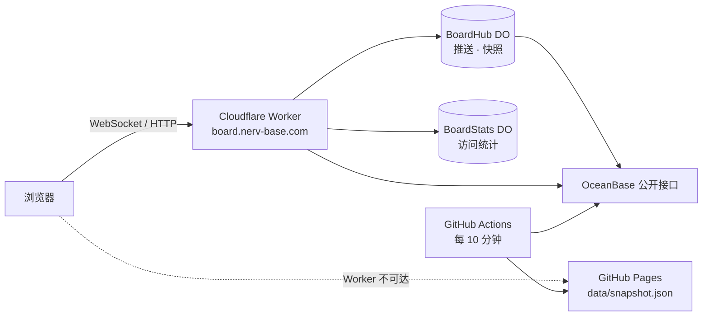

# 部署

> [!NOTE]
> 浏览器**不能**直接请求上游：任何非 `open.oceanbase.com` 的 `Origin` 都被网关 403，响应也没有 CORS 头，所以必须有一个中转。



## Cloudflare Worker（实时）

```bash
bun run worker:deploy                 # = bun run build && wrangler deploy
bunx wrangler secret put STATS_KEY    # 访问统计口令（可选）
```

- 域名在 `wrangler.jsonc` 的 `routes[].custom_domain`（当前 `board.nerv-base.com`，对应的 zone 必须在同一个 Cloudflare 账号下）。没用 `*.workers.dev`：部分网络对 workers.dev 的 SNI 被阻断。
- 静态资源 `dist/client`（Workers Assets，SPA 回退），只有 `/api/*` 先进 Worker。
- `/api/snapshot` 优先用 `BoardHub` 里 45 秒内的推送快照（直接回 gzip 字节），否则走边缘缓存（12 秒新鲜，300 秒内先回旧数据再后台刷新）。
- `/api/stream` 进 `BoardHub`（Hibernation API），有连接时每 15 秒 alarm 抓一次并广播，没人在线就停；新连接只会立刻收到 45 秒内的快照，更旧的不发。
- Durable Object 都是 SQLite 后端，状态用同步 KV（`ctx.storage.kv`）。
- 改了 `wrangler.jsonc` 后运行 `bun run types` 重新生成绑定类型。

## GitHub Pages（静态外壳 + 兜底快照）

`.github/workflows/pages.yml` 在 push 到 main 与每 10 分钟时运行：`bun test` → `bun run build:pages` → 部署 `dist/pages`。

- 页面优先读 Worker 实时接口（`LIVE_ORIGIN`），不可达时读同目录的 `data/snapshot.json`，顶栏显示「静态快照」。
- 上游抓取失败（总榜为空）时 job 失败，线上旧页面保持不变；部分赛道失败会记在快照的 `static.brokenBoards` 里。

## 任意主机

```bash
bun install --production
HOST=0.0.0.0 PORT=8791 bun run start
```

前面可以放任何反向代理；WebSocket 路径是 `/api/stream`。访问统计的数据存在 `STATS_DB`（默认 `.cache/stats.sqlite`）。
